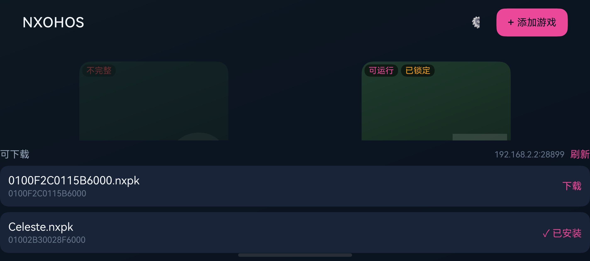
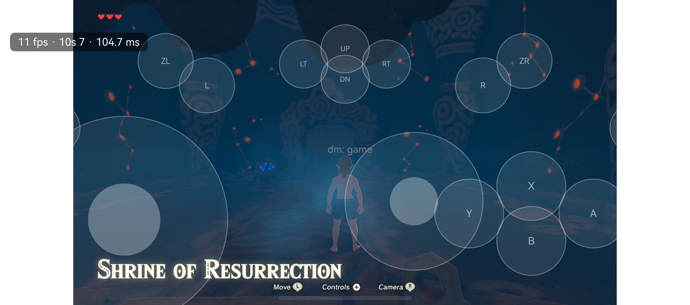

# nx2ohos — Switch 游戏原生移植到 HarmonyOS NEXT

把任天堂 Switch 游戏以**原生执行**方式搬到鸿蒙（HarmonyOS NEXT / OpenHarmony）：
不模拟 CPU，游戏 ARM64 机器码直跑，只 HLE 顶替 Horizon 系统调用，
NVN 图形调用离线翻译成 SPIR-V 后经 Vulkan 重放上屏。

> 当前状态：**一个 HAP 跑所有游戏**（宿主 + 运行时 profile），
> 真机运行《塞尔达传说：旷野之息》Shrine 场景 11 fps / 104.7 ms。
> 验证记录见 `docs/verify/`（G0.1–G1.5 闸门 PASS + [BOTW 真机记录](ohos-port/docs/verify/G1.6-BOTW.md) + 真机截图）。

## 仓库布局

```
nx2ohos/                上游 nx2ohos（main@3d98ec0）工作区快照 + 鸿蒙改动
├── nxnative/dm/ohos/       鸿蒙平台层（构建、HAP 壳、NAPI、present、音频、movie）
├── porter/platform_ohos.py porter --platform hap 流水线
└── nxnative/dm/            NSO 重写器 + dmhost 宿主运行时（复用上游，少量改动）
ohos-port/                  M0 探针工程（libprobe.so + PC 单测 + 闸门验收）
docs/                      两份技术方案报告（含全部里程碑与验收策略）
.trae/skills/nxohos-port/   移植开发 skill（给 AI 协作的开发规程）
```

## 运行方式

运行环境与游戏数据分离：应用只含宿主（≈3 MB），每个游戏的常量、着色器、资源都以 `.nxpk` 数据包分发，新增或更新游戏都不需要重新打包应用。

实测设备：HUAWEI Pura 70 Pro+（Kirin 9010 / Maleoon 910）。

### 安装应用

可安装的 HAP 在 [Releases](../../releases) 页面附件中下载，然后：

```bash
hdc file send nxohos-signed.hap /data/local/tmp/nx2a-e/entry-default-signed.hap
hdc shell 'bm install -p /data/local/tmp/nx2a-e -r -w 600'
```

`-r` 覆盖安装只替换运行环境，已安装的游戏数据不受影响。

### 游戏分发制作方式

1. porter 产出数据包目录：`RomFS/`、`mods/main.patched.bin`、`shaders.dmsv`、`env.txt`、`nx2a-data.json`
2. 打包成 `.nxpk`：

```bash
python dm/tools/pack_game.py --pack <数据包目录> --title <标题ID> --out <标题ID>.nxpk
```

   - 自动写入 `profile.tsv`：该游戏的模块列表、内存布局、帧率目标等常量，宿主启动时读取（不再编进 `libdmhost.so`）
   - `profile.tsv` 与全部文件一起参与 stamp；包格式为 GNU tar，支持超过 100 字节的文件名（《王国之泪》有 48 个）
   - 旧包没有 `profile.tsv` 时，宿主回退到构建内置的默认配置，仍然可玩
3. 把 `.nxpk` 放到任意 HTTP 静态目录，应用从库页的「可下载」拉取

### 游戏库启动

- 打开应用即游戏库；点卡片**直接开始游戏**，不需要再点一次列表
- 卡片状态按磁盘实况判定：**可运行** / **不完整**（缺 `RomFS/` 或 `mods/main.patched.bin`，点击提示重新导入）/ **已锁定**
- 游戏内返回即结束进程，下次打开回到库页

### 连接下载

- 库页底部「可下载」显示服务器地址（示例 `192.168.2.2:28899`），在设置中可修改
- 「刷新」拉取清单 →「下载」解包到 `games/<标题ID>/`，同 stamp 显示「√ 已安装」
- 服务端包变化（stamp 不同）时该游戏重新变为可下载
- 增量包只替换包内实际包含的顶层目录，不会清空未包含的目录（只更新着色器不会删掉 `RomFS/`）

### 实机画面





Shrine 场景实测 11 fps / 104.7 ms；全部杠杆与证伪过程见 [BOTW 鸿蒙性能优化经验](nx2ohos/BOTW鸿蒙性能优化经验.md)。

## 快速开始（当前基线）

```sh
# 1. T0 单测（PC 可跑，无真机）
python ohos-port/tools/verify/run_unit_tests.py
python ohos-port/probe/build_probe.py --host-check

# 2. 构建鸿蒙 dmhost（需 OHOS_SDK 环境变量）
cd nx2ohos/nxnative/dm/ohos
python build_ohos.py --game <TITLE_ID> --lib
python mkhap.py --game <TITLE_ID> --data <数据目录> --out <输出>

# 3. porter 全流水线（重写 → shader → host → 数据包 → HAP → 安装）
python -m porter port <游戏目录> -k prod.keys --platform hap [--install]
```

## 里程碑

| 阶段 | 内容 | 状态 |
|---|---|---|
| M0 | 设备能力验证（Vulkan/BCn/mmap/寄存器语义） | ✅ 真机 PASS（Pura 70 系） |
| M1 | 核心跑通（dmhost 构建 / NAPI 壳 / 上屏 / porter / 打包） | ✅ G1.3/G1.5 PASS，BOTW 真机出画面 |
| M2 | 输入 / 音频 / 生命周期 / 存档 | ⏳ 进行中 |
| M3 | 重型游戏与性能（多线程重放 / 帧率节奏 / 过场） | ⬜ |
| M4 | 工程化（GUI / 设备检测 / 崩溃采集 / 上游同步） | ⬜ |

详细技术方案见 [docs/](docs/) 两份报告；每个闸门的验收命令与结论见 `docs/verify/`。

## 合规与数据

- **本仓库不含任何游戏文件、密钥、固件**（.gamedump/、tools/、prod.keys 等均在忽略列表）。
- 游戏数据与密钥需用户自备，放在 `.gamedump/<Game>/`（git 忽略）。
- 上游：nxnative / nx2ohos，MIT。本仓库为衍生工作，见 [LICENSE](LICENSE)。

## 开发约定

- 闸门状态机：PASS / FAIL(#issue) / SKIP(依赖) / FLAKE，由 `archive_gate.py` 约束，
  修复涉及某闸门代码后必须重跑该闸门全部用例。
- 每款游戏的调校参数进 `dm/games/<title_id>/` 的 profile，不进通用代码。
- 提交信息用英文；日志红色行 `[RED] ` 表示未实现或错误。
