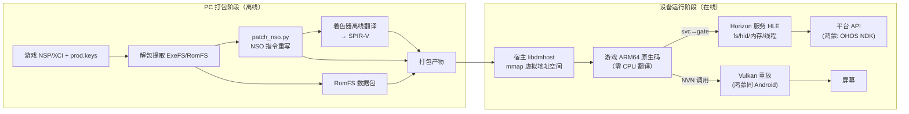
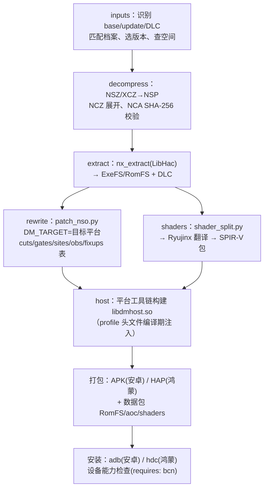
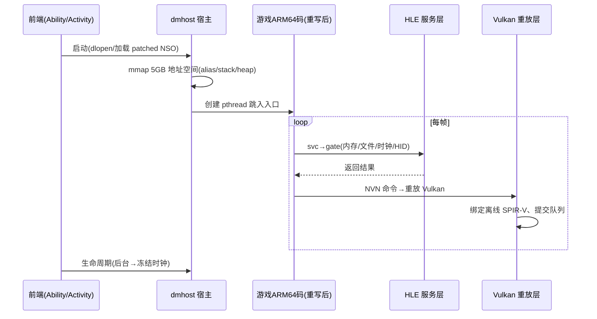

# Switch 游戏原生执行项目解读与鸿蒙（HarmonyOS NEXT）移植技术方案

> 调研对象：
> - **nxnative** — <https://github.com/seedds/nxnative>（把 Switch 游戏转成 iPhone/iPad/Mac 原生应用）
> - **nx2android** — <https://github.com/shirai91/nx2android>（同一套技术的 Android 版，产出原生 APK）
>
> 结论先行：两个项目是**同一技术的两个平台后端**。nx2android 是 nxnative 的 fork + Android 运行时。
> 鸿蒙移植应**基于 nx2android**（而非 nxnative），在 `dm/android` 之外新增 `dm/ohos` 平台层，
> 打包产物从 APK 换成 HAP，`adb` 换成 `hdc`。核心（重写器 + Horizon 宿主 + NVN/Vulkan 层）几乎原样复用。
> 分阶段实施与验收闸门（M0–M4 / Gxx / TC 用例）详见配套文档《鸿蒙移植_实现方案与验证策略》。

---

## 1. 项目解读：它们到底是什么

### 1.1 一句话原理

**不是模拟器，而是"静态重写 + 系统调用级 HLE"：**

- Switch 游戏本体就是 **AArch64（ARM64）机器码**（NSO/ExeFS 模块）。
- iPhone（A17 Pro+）、Mac（M 系列）、Android 旗舰（骁龙 8 的 Adreno 机型）、鸿蒙手机（麒麟）**同为 ARM64**。
- 因此游戏的 CPU 代码**不需要任何翻译/模拟**，改掉少量与"操作系统耦合"的指令后，可以**直接在目标 CPU 上原速执行**。
- 真正被"模拟"的只有两样：
  1. **Horizon OS（Switch 操作系统）**：内核系统调用（SVC）、文件系统、手柄 HID、生命周期等，由一个宿主运行时（dmhost）以 HLE（高级别模拟）方式顶替；
  2. **NVN 图形 API**：Switch 专属的图形接口，被"重放"到宿主 GPU API 上（iOS→Metal，Android→Vulkan，鸿蒙→Vulkan）。

### 1.2 两个项目的关系

```
d2r-mobile（首创该技术，移植《暗黑破坏神2：狱火重生》手机版）
   │
   ▼
nxnative (seedds)          iOS/Mac 后端：NSO重写器 + dmhost + NVN-on-Metal + IPA 打包
   │  fork
   ▼
nx2android (shirai91)      复用上游全部核心，新增 dm/android 运行时（Vulkan 后端、
                           NativeActivity 前端、NDK 构建、APK 打包、触屏手柄），
                           外面包了一层 PC 端 GUI/流水线（PySide6 + porter）
```

| 维度 | nxnative | nx2android |
|---|---|---|
| 目标平台 | iPhone 15 Pro+/iPad M1+/Apple Silicon Mac | Android（骁龙 Adreno / 三星 Xclipse） |
| CPU 执行 | 游戏 ARM64 码原生直跑 | 同左 |
| 图形后端 | NVN → Metal（SPIR-V 经 SPIRV-Cross 转 MSL） | NVN → Vulkan（直接消费 SPIR-V） |
| 着色器 | Ryujinx 着色器翻译器 → SPIR-V | 同左（复用，无需 SPIRV-Cross） |
| 系统调用 | 静态重写 SVC → 宿主 gate | 同左（同一套核心） |
| 打包产物 | IPA / .app（xcodegen + sideload） | APK + 数据包（NDK clang + mkapk.py） |
| 连接工具 | AltStore/Sideloadly | adb |
| 硬件门槛 | BC 纹理压缩（A17 Pro+/M1+） | BC 纹理压缩（Adreno/Xclipse，Mali/PowerVR 不行） |
| 支持游戏 | 60+ 款（含王国之泪、马里奥奥德赛等） | 20+ 款，60fps 为主 |

### 1.3 与传统模拟器（yuzu/Skyline/Ryujinx）的本质区别

| | 传统模拟器 | nxnative / nx2android |
|---|---|---|
| CPU | 主流为 JIT 重编译/解译（Android 端部分也用 NCE 直跑），兼容层厚重 | **零 CPU 翻译** + 极薄兼容层，原速执行 |
| GPU | 模拟 Maxwell GPU + 命令流解析，运行时翻译着色器 | **离线**（打包时）完成着色器翻译，运行时只重放 |
| 兼容性 | 广（一个模拟器跑所有游戏） | 窄（每款游戏需要一份"游戏档案 profile"调校） |
| 产物形态 | 一个播放器 + 游戏文件 | **每款游戏一个独立 App**（有图标、独立包名） |
| 性能 | 受限于 JIT 与运行时翻译 | 接近原生，旗舰机 60fps |

---

## 2. 核心原理剖析（四大机制）

### 2.1 NSO 重写器（`dm/tools/patch_nso.py`）— 解除游戏码对 Horizon 的耦合

对游戏的 NSO 模块做**静态指令改写**，解决游戏码与 Horizon 内核耦合的三类指令：

1. **`svc #n` 系统调用** → 改写为跳转到"宿主 gate"（跳板代码），进入 C 宿主函数，由 `hle_svc.c` 分发处理（`<0x80` 内核服务；`>=0x80` 宿主扩展）。
2. **`mrs xN, cntpct_el0` 计时器读取** → 同样改写到 gate，由宿主提供单调时钟。
3. **平台寄存器冲突**：
   - `x18`：宿主 OS 保留给平台用（Android/iOS/鸿蒙同）→ 游戏对 x18 的读写重定向到"线程槽 K18"（经 `tpidrro_el0` 间接寻址）；
   - `tpidr_el0`（TLS）/`tpidrro_el0` → 分别映射到线程槽 KTLS/KTLR（对应 Horizon 的 ThreadLocalRegion）。
4. **Key Page 机制**：在数据段尾部放一个"密钥页"，补丁代码通过它间接取线程槽编号，让加载器可任意分配槽号。
5. **远/近补丁布局**：AArch64 分支指令只有 ±128MB 范围；补丁区若紧跟在超大 bss 段（如《密特罗德：生存恐惧》~1.8GB 静态堆）之后，与代码的距离会超出约 112MB 的判定阈值 → 补丁区前移（FAR 布局，置于模块基址前 32MB）。
6. 产出多张**按 build ID 索引的诊断/修订表**：`cuts.tsv`（二进制覆写，先校验原字节）、`gates.tsv`、`sites.tsv`、`obs.tsv`（观察门）、`fixups.tsv`。
7. **更新自适应**：`nso_match.py` 用 `.eh_frame_hdr` 提取函数边界 + 指纹匹配，让老补丁套用到新版本；`sdk_patches.py` 按任天堂 SDK 版本批量套补丁。

### 2.2 宿主运行时（`dm/host`，即 dmhost）— 顶替 Horizon OS

- **地址空间**：`mmap(PROT_NONE, MAP_ANON)` 一次性预留 ~5GB（可按档案扩到更大）虚拟空间，`PROT_NONE` 预留不占物理内存；划分为 **Alias 区**（MapPhysicalMemory 虚拟地址内存）/ **Stack 区** / **Heap 区**（SetHeapSize/QueryMemory/MapPhysicalMemory 等 SVC 就地实现）。Android 侧有 `--alias-headroom`（0–48GB）应对不同 build 的地址预留差异。
- **线程与同步**：Horizon 线程 → pthread；同步语义（地址仲裁器 address arbiter、条件变量）参考 Atmosphère mesosphère 实现（Linux futex 天然贴合）。
- **符号 Hook**：游戏对 `nn::fs`、`nn::oe` 等 SDK 服务的导入，通过自定义节（`swhle`/`swforce`）在加载时按名字哈希解析到宿主实现，未实现的落到日志桩。
- **对象管理**：`objmap_*` 开放寻址哈希表，游戏指针 ↔ 宿主对象。
- **UE 内存桥**（`hle_uemalloc.c`）：虚幻引擎 FMallocBinned3 会预留天文数字地址空间，宿主把 Malloc/Realloc/Free 通过 vtable 槽位（UE3/UE4_27/UE5/UE5_6）直连宿主 malloc。
- 其余子系统：`hle_fs.c`（文件系统/存档）、`hle_hid.c`（手柄/触摸）、`hle_vi.c`（显示）、音频、视频解码、生命周期 applet。

### 2.3 图形层（`dm/gfx`）— NVN 重放

- **HLE NVN**（`hle_nvn.c`）：实现 NVN API 表，记录游戏提交的命令；
- **后端重放**：iOS 用 `nvn_mtl.m`（Metal），Android 用 `gfx_vk_*`（Vulkan）；来自 MacNativeGames 的修复包括 8 位索引 GPU 扩宽、in-pass clear、王国之泪可见性计数器下放；纹理解 swizzle 算法则在 `nvn_tex.c`（源自 deko3d），不属于 MacNativeGames 贡献；
- **着色器离线翻译**（打包阶段完成）：
  - 游戏 GLSL → glslang → SPIR-V；
  - 游戏 NVN 着色器字节码 → Ryujinx 着色器翻译器（C#，仓库内置）→ SPIR-V；
  - iOS 再用 SPIRV-Cross 转 MSL；Android 直接喂 SPIR-V（**鸿蒙同样直接喂 SPIR-V**）；
  - 纹理格式依赖 **BC 压缩**的 GPU 硬件解码（这是 Adreno/Xclipse/A17 Pro+/M1+ 的门槛，Mali/PowerVR 不支持 → 鸿蒙麒麟 GPU 是最大风险点，见 §7）。
- **设备端着色器捕获**：Xenoblade 3 等游戏的着色器不在游戏文件里（运行时生成），设备端把缺失着色器存 `captured_shaders/`，回传 PC 翻译后二次打包。

### 2.4 游戏档案（`dm/games/<title ID>/`）— 数据驱动的每游戏调校

- `game.tsv`：通用键（内存布局、帧率上限、引擎类型等）；
- `patches.py`：该游戏各 build 的重写器剪裁（cuts）；
- 着色器表：`shader_map.tsv` / `pso_pairs.tsv` / `shader_facts.tsv` 等（SPIR-V 与游戏内 PSO 的配对）；
- `android.tsv`：Android 专属键（status/tested/package/orientation/requires:bcn/setting/env/overlay 虚拟按键位置）；鸿蒙对应新增 `ohos.tsv`（键集相同，见 §6.3）；
- 档案在打包时由 `build.py` **编译进宿主**（生成 `game_profile.h` / `android_profile.h`），所以每款游戏 = 一个宿主 so + 一个 APK，构建只要几秒。

---

## 3. 项目目录结构

### 3.1 nxnative（iOS/Mac 上游）

```
nxnative/
├─ scripts/
│  └─ build_ipa_from_nsp.py      # 一键打包入口：NSP→IPA/.app 全流程
├─ dm/
│  ├─ tools/                     # 静态分析/重写器 ★核心
│  │  ├─ patch_nso.py            #   NSO 指令重写（svc/x18/tls/timer→gate）
│  │  ├─ nso_match.py            #   跨版本函数指纹匹配
│  │  ├─ sdk_patches.py          #   按 SDK 版本的通用补丁
│  │  ├─ shader_split.py         #   从 RomFS/DLC 中剥离着色器
│  │  └─ nx_extract/             #   LibHac(.NET) NSP/XCI 解包
│  ├─ host/                      # Horizon 宿主运行时 ★核心
│  │  ├─ loader.c                #   重写后模块的加载与内存布局
│  │  ├─ hle_svc.c               #   SVC 分发、地址空间（alias/stack/heap）
│  │  ├─ hle.c / hle_table.c     #   gate 分发、符号 hook（swhle 节）
│  │  ├─ hle_fs.c                #   文件系统/存档
│  │  ├─ hle_hid.c               #   手柄/触摸/振动
│  │  ├─ hle_os.c / hle_account.c / hle_uemalloc.c ...
│  │  └─ entry.S                 #   线程入口、gate 跳板、未实现桩
│  ├─ gfx/                       # NVN 图形层 ★核心
│  │  ├─ nvn/hle_nvn.c           #   NVN API HLE
│  │  ├─ nvn/nvn_mtl.m           #   Metal 后端（iOS/Mac）
│  │  └─ ...
│  ├─ games/<titleID>/           # 每游戏档案（game.tsv/patches.py/着色器表）
│  ├─ ios/                       # iOS App 前端（触摸/生命周期）
│  └─ third_party/               # 仓库内置：Ryujinx 着色器翻译器、flip、dav1d、libvpx、stb_vorbis、vulkan-headers
│                                #   （SPIRV-Cross 与 glslang 为外部工具依赖，brew 安装，不在本目录）
└─ docs/                         # development.md、agents/（AI 移植工作流手册）
```

### 3.2 nx2android（Android，鸿蒙移植的直接基座）

```
nx2android/
├─ gui/                          # PySide6 桌面 GUI（Setup/Port/Saves 三个标签页）
│    └─ 调 `python -m porter port … --progress json`，画 JSON 事件
├─ porter/                       # 无头移植流水线（也可 CLI）
│  ├─ dumps.py                   #   NSZ/XCZ 解压→NSP、NCZ 展开、NCA 校验
│  ├─ fpslocker.py               #   --fps60：拉取 FPSLocker-Warehouse 社区配置
│  └─ …                          #   inputs→extract→rewrite→shaders→host→apk→data→install
├─ nxnative/                     # 上游 fork + Android 移植
│  ├─ dm/{host,gfx,tools,third_party}/   # 与 iOS 共享的核心（DM_ANDROID/DM_TARGET 条件编译）
│  ├─ dm/android/                # ★Android 平台层（鸿蒙要新写对应物）
│  │  ├─ front_android.c         #   NativeActivity 前端：虚拟手柄/暂停菜单/设置/
│  │  │                          #   存档管理/文字输入/振动/摇一摇/音频/性能提示(ADPF)
│  │  ├─ gfx_vk_*.c              #   Vulkan 重放后端（鸿蒙可直接复用）
│  │  ├─ saves_android.c         #   存档导出/导入（沙盒 files/saves/）
│  │  ├─ build.py                #   NDK 增量构建 libdmhost.so
│  │  ├─ apk/mkapk.py            #   APK 写入与签名（鸿蒙→mkhap.py）
│  │  ├─ tools/shader_vk.py      #   SPIR-V 着色器包生成
│  │  ├─ tools/android_profile.py#   生成 android_profile.h
│  │  ├─ overlay_default.tsv     #   虚拟手柄布局（平板/手机两套）
│  │  └─ themes/                 #   每游戏手柄皮肤
│  └─ dm/games/<titleID>/        # 档案 + android.tsv
├─ packaging/                    # 玩家发行包（PyInstaller 单文件 GUI + INSTALL.md）
└─ devtools/                     # 连机调试（push/录屏/soak 测试；NX2A_DEVICE）
```

---

## 4. 关键路径（两条主线）

**A. 打包主线（PC 离线，每款游戏一次）：**

```
游戏文件夹(NSP/XCI/NSZ/XCZ) + prod.keys
 → inputs      选定 base/update/DLC 与版本，校验磁盘空间
 → decompress  NSZ/XCZ→NSP（porter/dumps.py，临时目录 tmp/dumps/）
 → extract     nx_extract(LibHac) → extract/<ver>/{ExeFS,RomFS} + aoc/
 → rewrite     patch_nso.py（DM_TARGET=android）→ android/patched_<ver>/
 → shaders     shader_split.py → Ryujinx 翻译器(dmsh_xlate) → shader_vk.py
               → shader/pkg + shaders.dmsv
 → host        dm/android/build.py --release（NDK clang）→ libdmhost.so
               （game_profile.h/android_profile.h 编译期注入）
 → apk         mkapk.py + 玩家自签 → <App>.apk
 → data        RomFS/aoc/shaders/env.txt/settings.txt → <App>-data/
 → install     adb install + 数据推送 + requires(bcn) 设备检查
```
（慢阶段全部有输入哈希缓存，二次打包秒级）

**B. 运行时主线（设备在线）：**

```
用户点开 App
 → NativeActivity onCreate → dlopen libdmhost.so
 → dmhost 初始化：mmap 5GB 虚拟地址空间 / 读 profile / 装载 patched NSO
 → 按 fixups.tsv 布局加载，注册 g_gate 哈希表（ret 地址→处理函数）
 → 创建游戏主线程（pthread），跳入游戏入口
 → 游戏执行 ARM64 原生码
     ├─ svc → gate → hle_svc/hle_fs/hle_hid…（宿主服务）
     ├─ NVN 调用 → hle_nvn 记录 → gfx_vk 重放 Vulkan（SPIR-V 已离线就绪）
     ├─ 线程/同步 → pthread/futex（Atmosphère 语义）
     └─ HID → 触屏/手柄事件注入 → 游戏
 → 前端叠加层：虚拟手柄/暂停菜单/存档导出导入
 → 生命周期：onPause/onResume ↔ 宿主冻结/恢复（DM_DETCLOCK 冻结时钟）
```

---

## 5. 解析流程图（Mermaid）

### 5.1 总体原理



### 5.2 移植流水线（porter 各阶段）



> 图注：§4 主线中 data 为独立阶段且 install 含数据推送；本图为 Mermaid 简化——数据包并入 PKG 节点、
> extract→shaders 与 rewrite 为并行分叉。与 porter 实际 stage 图（配套文档 M1.4）的口径以此注为准。

### 5.3 运行时调用流



---

## 6. 鸿蒙移植路径：为什么以及怎么走

### 6.1 选型：基于 nx2android 移植（决定性理由）

| 依据 | 说明 |
|---|---|
| **同为 ARM64 + Linux 系内核语义** | HarmonyOS NEXT 官方口径为"自研鸿蒙内核"（OpenHarmony 标准系统为 Linux LTS 内核；NEXT 设备第三方实测为 Linux 5.10/6.6）。EL0 可见的 POSIX 语义——`mmap` 大块 `PROT_NONE` 预留、futex、pthread、EL0 读取 `cntpct_el0`/`tpidrro_el0`——与 Android 的一致性以 M0 实测为准 → **重写器与宿主核心预期近零改动** |
| **图形同为 Vulkan** | 鸿蒙原生支持 Vulkan（`VK_OHOS_surface` WSI 扩展 + OHNativeWindow），`gfx_vk_*` 后端直接复用；而 nxnative 的 Metal 后端对鸿蒙毫无用处 |
| **着色器管线直接复用** | 鸿蒙 Vulkan 直接消费 SPIR-V，`shader_split.py → dmsh_xlate → shader_vk.py` 一字不改 |
| **平台层已解耦** | 上游用 `DM_ANDROID/__APPLE__/DM_TARGET` 宏隔离平台差异，模仿 `dm/android` 新建 `dm/ohos` 即可，符合项目自身的分层规则 |
| **打包流水线已工程化** | porter 各阶段有缓存键，只需替换 host 构建工具链、apk 打包阶段、install/数据推送三处（其中安装与数据推送换 hdc 后端） |

### 6.2 平台层映射总表（Android → HarmonyOS NEXT）

| 能力 | nx2android（Android） | 鸿蒙方案（新增 `dm/ohos/`） | 工作量 |
|---|---|---|---|
| 应用壳 | NativeActivity | UIAbility + ArkTS 页面 + **XComponent**（type: surface，拿到 OHNativeWindow*） | 新写 |
| 原生入口 | `ANativeActivity_onCreate` | NAPI 模块 `napi_init`，XComponent 回调（OnSurfaceCreated/Changed/Destroyed、触摸）透传给宿主 | 新写 |
| 图形 WSI | `VK_KHR_android_surface` | `VK_OHOS_surface`（扩展自 API 10 起；经 `vkCreateSurfaceOHOS`，OHNativeWindow 填入 `VkSurfaceCreateInfoOHOS.window`，产物为 VkSurfaceKHR）；其余 `gfx_vk_*` 不变 | 小改 |
| 线程/同步 | pthread/futex | 相同（musl libc） | 零 |
| 内存 | mmap 5GB 预留 + alias-headroom | 相同；关注鸿蒙按应用的内存上限与 LMK 策略 | 复用+调参 |
| 构建 | NDK clang（build.py） | OHOS SDK：`clang -target aarch64-linux-ohos --sysroot=$SDK/native/sysroot`；build.py 加 ohos 分支 | 小改 |
| 打包 | `apk/mkapk.py` + 自签 | 新写 **`hap/mkhap.py`**：优先封装官方 **hap_packing_tool**（HAP 内为编译后的 module.json + `libs/arm64-v8a/*.so` + resources.index + pack.info；app.json5 属 App Pack(.app) 层，仅打 .app 时需要），**hap-sign-tool** 签名；versionCode 语义同 Android（游戏版本+1 防降级） | 新写 |
| 安装/联机 | adb install / file push | `hdc install *.hap` / `hdc file send/recv -b <bundle>`（官方沙盒通道，要求 debug 证书签名且应用已在设备上启动）；porter 的 install 阶段与数据推送换 hdc 后端（见 §7 风险 7） | 小改 |
| 数据包位置 | `/sdcard/Android/data/<pkg>/files` | 应用沙盒：进程内用 `context.filesDir` 返回的沙箱路径（形如 `/data/storage/el2/base/files`，**不要在进程内拼物理路径**）；hdc 推送/外部查看走物理路径 `/data/app/el2/100/base/<bundle>/...`；大 RomFS 用 hdc `-b` 通道推送或首启从用户目录导入 | 小改 |
| 音频 | AAudio | **OH_Audio**（OH_AudioStreamBuilder RENDERER，API 形态与 AAudio 极近）；`hle_audio` 加 ohos 后端 | 小写 |
| 触摸 | ANativeActivity 触摸回调 | **OH_NativeXComponent 原生 TouchEvent 回调**（native 直收，不经 ArkTS 中转；ArkUI 仅兜底文本输入等场景） | 新写 |
| 手柄 | Android InputDevice | `@ohos.multimodalInput`（inputDevice/keyEvent）或 OH_Input 原生接口（真机手柄覆盖面以实测为准）；无手柄设备靠虚拟手柄 | 新写 |
| 振动 | Android vibrator | `@ohos.vibrator`（NAPI 桥） | 小写 |
| 帧率节奏 | ADPF/Choreographer | **OH_DisplaySoloist**（vsync 对齐）+ **QoS API**（OH_QoS_SetThreadQoS 替代性能提示） | 小写 |
| 电量/热态 | ADPF thermal 侧 | `@ohos.batteryInfo` + `@ohos.thermal`（getLevel/ThermalLevel）；M3 帧率闸门以此为热态前置依据 | 小写 |
| 摇一摇（甩帽子） | 加速度计 | `@ohos.sensor` / OH_Sensor（加速度计判定 shake） | 小写 |
| 剪贴板 | Android Clipboard | `@ohos.pasteboard`（NAPI 桥；与文字输入共用） | 小写 |
| 权限声明 | AndroidManifest 权限 | module.json5 声明：`ohos.permission.VIBRATE`（振动）、`ohos.permission.INTERNET`（devtools 联机）等，逐能力核对 | 小改 |
| 文字输入 | Android IME | ArkUI TextInput 弹出 → NAPI 回传宿主 | 小写 |
| 存档 | 沙盒 files/saves + renameat2 原子交换 | 基本相同；注意 musl 到 2024 年才合入 renameat2 wrapper，OHOS musl fork 基线未承诺——优先 `syscall(SYS_renameat2,…)` 直调 + 运行时探测，兜底"临时文件+rename"，并在 M0 实测沙盒文件系统对 `RENAME_EXCHANGE` 的支持 | 复用+探测 |
| 60fps | fpslock.tsv / FPSLocker-Warehouse | 原样复用（与平台无关） | 零 |
| 着色器捕获 | files/captured_shaders 回传 | 相同路径（沙盒内），porter 拉取阶段换 hdc | 复用 |

### 6.3 新增模块设计（模仿 dm/android 的分层规则）

```
nx2android/
├─ nxnative/dm/ohos/                # ★新增：鸿蒙平台层（与 dm/android 平级）
│  ├─ front_ohos.c                  # 宿主前端：事件循环、虚拟手柄、暂停菜单、设置
│  ├─ napi_bridge.c / .h            # NAPI ↔ 宿主：触摸/键值/生命周期/振动/剪贴板
│  ├─ wsi_ohos.c                    # VK_OHOS_surface 创建、OHNativeWindow 绑定
│  ├─ audio_ohos.c                  # OH_Audio 渲染器后端
│  ├─ media_ohos.c                  # 过场动画（AVPlayer/AVCodec 双路径 + 降级策略）
│  ├─ saves_ohos.c                  # 沙盒存档（复用 saves_android 的目录协议）
│  ├─ perf_ohos.c                   # DisplaySoloist + QoS + 电量/热态
│  ├─ build_ohos.py                 # OHOS SDK 工具链构建 libdmhost.so（生成 ohos_profile.h）
│  └─ hap/mkhap.py                  # HAP 打包（封装 hap_packing_tool）+ hap-sign-tool 签名
├─ porter/                          # 增 ohos 分支：--platform hap（host 工具链、打包、hdc 安装）
└─ gui/                             # 平台选择：Android APK / HarmonyOS HAP
```

核心层条件编译增加 `DM_OHOS`（与 `DM_ANDROID` 走几乎相同的代码路径，仅平台 API 不同）。
每游戏档案在 `dm/games/<titleID>/` 下新增 **`ohos.tsv`**（键集同 android.tsv：status/tested/package/orientation/requires/setting/env/overlay），打包时由 build_ohos.py 生成 `ohos_profile.h` 编译进宿主。

---

## 7. 关键技术点与风险清单

| # | 风险点 | 等级 | 说明与对策 |
|---|---|---|---|
| 1 | **BC 纹理压缩** | ★★★ 最高 | 游戏纹理是 BC1–7，Android 端只有 Adreno/Xclipse 支持。麒麟侧：Mali 时代（Kirin 9000/9000E 及更早，Mali-G78）不支持 BC；Kirin 9000S 起改用华为自研 Maleoon GPU（910/920，Mate 90 系列麒麟 9030 为新一代 Maleoon），其 Vulkan 对 BCn 的支持公开资料未明确（华为公开的纹理压缩是自研 HEBC），**必须真机实测**。对策：M0 阶段用 `vkGetPhysicalDeviceFormatProperties2` 探测（见配套文档 M0.3/G0.3 闸门）；不支持则**离线把 BCn 转码为 ASTC**（bcdec + astcenc，BCn→RGBA8→ASTC 两步），在 porter 增加纹理转码阶段（牺牲包体/加载时间换兼容） |
| 2 | Vulkan 驱动质量 | ★★★ | Mali 驱动历史兼容性差（上游直接排除）；Maleoon 是新驱动，SPIR-V 特性覆盖需逐游戏验证。另外上游在 Adreno 上还依赖社区 Turnip 自定义驱动优化（如王国之泪），该路径在鸿蒙侧不能直接套用，需评估系统驱动的能力上限。线程亲和性（若补丁用 pthread_setaffinity_np）在鸿蒙的支持度未验证，性能意图优先用 QoS 表达。对策：先选一款轻量游戏（Celeste/Unpacking 级别）做打通验证，再上王国之泪 |
| 3 | 5GB 虚拟地址预留 | ★★ | 鸿蒙按应用内存管理/LMK 更激进；`PROT_NONE` 预留本身不占物理内存，但 alias 区实际映射（+8GB headroom 场景）可能触限。对策：实测 `--alias-headroom` 各档位；必要时把大地址余量列为高端设备的特性要求（档案 `requires`） |
| 4 | x18/tpidr 语义 | ★★ | Android(bionic) 已验证；鸿蒙(musl) 同为 Linux 内核语义，理论一致，但需验证 EL0 读 `tpidrro_el0` 行为与 TLS 槽方案在 musl 下无冲突 |
| 5 | W^X / 代码页 | ★ | iOS 需要 MAP_JIT；Android 已由上游验证可行加载路径。鸿蒙沙箱的 SELinux 型策略与数据目录 noexec 挂载行为未公开承诺——**理论可行、以 M0 实测确认**（配套文档 M0.5 已含可执行页探针）；如失败走匿名内存 + mprotect 的 loader 路径 |
| 6 | 签名与分发 | ★★ | 鸿蒙侧载比 Android 严：自用需**调试证书 + 在 AGC 注册设备**（实名开发者调试证书有效期 1 年、未实名 14 天；每账号最多 2 张调试证书；调试设备每年注册上限 100 台，来源：华为 AGC 官方文档）。不能像 APK 那样随便传装；公开分发需上架审核（不可能过审）。对策：定位为个人自用工具 |
| 7 | 数据包安装 | ★ | HAP 不宜内置数 GB RomFS；用官方 hdc 沙盒通道 `hdc file send/recv -b <bundle>` 推送（要求 debug 证书签名且应用已在设备上启动一次）或首启从用户目录导入。上游"FUSE 属主"坑在鸿蒙不存在（沙盒机制不同）；沙盒写入的实测结论以配套文档 TC0-1-3 为准 |
| 8 | 音视频解码 | ★★ | 过场动画（hle movie）在 Android 用的解码器需换鸿蒙 **AVPlayer/AVCodec**（配套文档 M3.5/G3.5 已列验证项与降级策略：跳过或 ≤3s 黑屏占位）；部分游戏依赖的专有解码路径上游也是 Mac 端捕获方案 |
| 9 | 版本演进 | ★ | 上游活跃迭代（最新发布 v0.2.0（2026-10-31），开发版已到 v0.3.0，Switch 2 游戏也开始了）；建议作为 fork 长期跟上游 rebase，控制自有改动集中在 `dm/ohos` 目录、porter 的 host 构建/打包/安装三处、以及各游戏档案的 `ohos.tsv` |
| 10 | **后台管控/长时任务** | ★★ | HarmonyOS NEXT 对后台应用采取严格挂起/冻结策略：游戏前台运行无碍，但"首启从用户目录导入 RomFS""着色器包回传""后台导出存档"等流程一旦退后台会被挂起。对策：导入/回传期间申请长时任务（backgroundTaskManager，类型受白名单限制）或提示用户保持前台；该对策已列入配套文档 M2/M3 验证前置 |

---

## 8. 分阶段实施计划

**M0 环境与验证**
- DevEco Studio + HarmonyOS NEXT 真机（麒麟 9000S/9010/9020 的 Maleoon 机型优先，Mate 90 系列可一并覆盖）
- 验证：Vulkan 可用性与 `VK_OHOS_surface`、BCn 格式探测、mmap 5GB 预留、pthread/futex、EL0 寄存器语义、hdc 写沙盒 → 产出《设备能力报告》（即配套文档的 `probe_report.json`，M0.1–M0.5 探针工程）决定后续路线（原生 BCn vs ASTC 转码）

**M1 核心跑通（最薄切片）**
- clone nx2android；porter 加 `--platform hap`
- 写 `dm/ohos`：NAPI 壳 + XComponent + wsi_ohos + build_ohos.py + mkhap.py
- 选一款已支持轻量游戏（如 Celeste）：NSP → HAP，真机出画面

**M2 输入/音频/生命周期/存档**
- 触摸/虚拟手柄/暂停菜单、OH_Audio、前后台切换（时钟冻结）、存档导出导入
- 目标：可完整玩通 2–3 款 2D/轻 3D 游戏

**M3 重型游戏与性能**
- 王国之泪/马里奥奥德赛级：着色器包、多线程重放（--mt-replay）、DisplaySoloist 帧率节奏、QoS、内存调参
- 过场动画（AVPlayer/AVCodec，对应配套文档 M3.5）
- ASTC 转码线（视 M0 探测结论启动）

**M4 工程化**
- GUI 增加鸿蒙目标、设备能力自动检测（缓存为 `capability.json`，随系统版本失效重探）、异常日志采集、跟上游同步机制

---

## 9. 法律与合规提示（项目自带立场）

- 两个项目均**不含任何游戏文件与密钥**，要求用户提供自己机器 dump 的 NSP/XCI 与 `prod.keys`；
- 转换产物（HAP/APK）含游戏代码，**禁止传播**；
- 2026 年 2 月任天堂已对 GitHub 上 13 个 Switch 模拟器仓库发出下架通知——本项目"转好即玩、不托管游戏"的形态降低但**不消除**风险；自用研究请自行评估当地法律。

---

## 10. 审核记录（修订日志）

本文档经 6 轮审核修复后交付：

| 轮次 | 重点 | 主要修复 |
|---|---|---|
| 1 | 事实校准 | 麒麟 GPU 代际（Kirin 9000S 起为 Maleoon，非 Mali）；模拟器 CPU 描述补充"Android 端部分也用 NCE"；mmap 参数修正为 `PROT_NONE, MAP_ANON`；FAR 补丁布局的超距机制精确到 112MB 阈值 |
| 2 | 风险清单 | 补充 Turnip 驱动依赖在鸿蒙不可套用的说明；移除无出处的证书有效期数字；hdc 写沙盒加"实测为准"护栏；修正"三个点"表述 |
| 3 | 实施计划与细节 | 移除里程碑时间估计；触摸改为 OH_NativeXComponent 原生回调（不经 ArkTS 中转）；手柄支持加实测护栏；沙盒路径改为"以系统 API 返回为准" |
| 4 | 一致性 | 安装行与风险 7 表述统一；§6.1/§6.3/风险 9 的改动范围口径统一 |
| 5 | 完整性 | 新增本修订日志；核对全部 Mermaid 图语法与正文交叉引用（§7、§6.3、mkhap.py 路径） |
| 6 | 终检 | 术语统一（鸿蒙/HarmonyOS NEXT、dm/ohos）；核对标题层级与章节编号连续性 |

**第二轮审核（subagent 协作，3 轮审核 + 修复 + 复核 + 终检）：**

| 轮次 | 审核方 | 主要修复 |
|---|---|---|
| 1 | 事实核对 agent（联网比对上游 GitHub/DeepWiki） | 版本口径更正（最新发布 v0.2.0，开发版 v0.3.0）；third_party 内置组件清单按 `dm/third_party/README.md` 更正（SPIRV-Cross/glslang 为外部依赖）；MacNativeGames 贡献归属修正（纹理解 swizzle 源自 deko3d，移出其名下；补可见性计数器下放） |
| 2 | 鸿蒙技术 agent（核对华为官方文档） | "内核为 Linux"改为官方口径+实测并重的谨慎表述；filesDir 沙箱路径与 el2 物理路径区分；HAP 结构更正（libs/arm64-v8a、app.json5 属 App Pack 层、优先封装 hap_packing_tool）；renameat2 表述谨慎化；映射表补电量/热态、摇一摇、剪贴板、权限声明四行；新增风险 10（后台管控/长时任务）；风险 5 W^X 改"实测确认"；风险 6 补证书有效期/设备数出处；风险 7 升级为官方 hdc -b 沙盒通道；Maleoon 代际修正（910A 无出处，补 9030）；VkSurfaceCreateInfoOHOS 签名更正；线程亲和性提示 |
| 3 | 一致性 agent（对照实现方案 B） | 补 §6.3 media_ohos.c、§8 M3 过场动画（风险 8 的实现落点，由配套文档 M3.5/G3.5 承载验证）；补 ohos.tsv/ohos_profile.h 口径并放宽风险 9 改动范围；§7 风险 7/§8 增加对配套文档的引用（《设备能力报告》=probe_report.json、capability.json、TC0-1-3）；风险 1 对策统一为 Properties2+G0.3；§5.2 加图注；A17+→A17 Pro+；标点修正 |

> 注：文中所有针对鸿蒙平台的具体行为（Vulkan/BCn 支持、hdc 沙盒写入、手柄覆盖面）均标注了验证方式，以 M0 阶段真机实测结论为最终依据。

---

## 11. 参考资料

- nxnative：https://github.com/seedds/nxnative （README / docs/development.md / docs/agents/）
- nx2android：https://github.com/shirai91/nx2android （docs/ARCHITECTURE.md / DEVELOPMENT_GUIDE.md / PORT_CHECKLIST.md）
- 架构解析：https://deepwiki.com/seedds/nxnative
- 技术源头：https://github.com/jhaizhou-ops/d2r-mobile
- 依赖参考：Ryujinx（着色器翻译器）、Atmosphère mesosphère（内核语义）、LibHac（NSP 解析）、SPIRV-Cross / glslang、MacNativeGames
- 媒体报道：TweakTown / NotebookCheck / ResetEra（2026-10）
